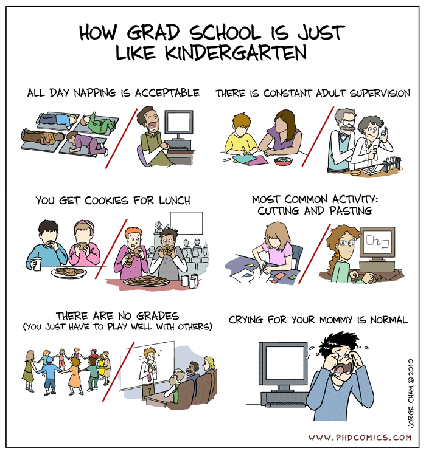

{fig-align="center" height="650px" fig-alt="PHD Comics strip titled How Grad School Is Just Like Kindergarten, six paired panels comparing kindergarteners to grad students: all-day napping is acceptable, there is constant adult supervision, you get cookies for lunch, the most common activity is cutting and pasting, there are no grades (you just have to play well with others), and crying for your mommy is normal."}

::: {.cite-note}
Copyright &copy; 2010 by Jorge Cham &middot; Source: [@phdcomics_kindergarten]
:::

---

## Upcoming

| What | When | Points |
|---|---|---|
| **NSF GRFP reference letters** | Oct. 16 (today), 8:00 PM ET | &ndash; |
| **NSF GRFP deadline** &ndash; Physics & Astronomy | Oct. 23, 8:00 PM ET | &ndash; |
| Astrophysics/Astro Graduate Q&A (Room CCB 103) | Nov. 12, 3:30&ndash;4:30 PM ET | &ndash; |
| [Personal statement or cover letter](../assignments/personal-statement.qmd) | Nov. 20, 11:59 PM ET | 15% |

::: {.highlight-box}
**The goal of today's lecture:** leave with the start of a program list, and a plan for who to contact.
:::

---

## Part I: Two ways to a graduate degree

:::: {.columns style="font-size: 0.85em;"}
::: {.column width="50%"}
### Direct PhD

- The U.S. physics norm: apply straight from your B.S.
- **Funded:** tuition waiver plus a stipend (CoS GT: $37,500/yr for the 2026-27 academic year)
- About 5&ndash;6 years; often M.S. along the way
:::
::: {.column width="50%"}
### Terminal M.S.

- 1&ndash;2 years, coursework or thesis
- **Often self-funded**; or funded via external job
- Primarily a route to industry
:::
::::

::: {style="font-size: 0.85em;"}
**PhD abroad:** in much of Europe a **master's comes first**, then a 3&ndash;5 year PhD, often a paid position with a named supervisor (e.g., Germany, the Netherlands). UK research-council funding for international students is capped at 30% of awards.

Also consider engineering, materials science, optics, medical physics, and astronomy.
:::

::: {.cite-note}
[@aip_firstyear2019; @rig_faq; @uva_kdvi_phd; @ukri_intl2021]
:::

---

## Georgia Tech BS/MS: a fifth year here

::: {style="font-size: 0.72em;"}
:::: {.columns}
::: {.column width="50%"}
### BS/MS in Physics

For Physics, Applied Physics, and Astrophysics majors.

- To apply: &ge; 30 GT credit hours, &ge; 3.3 GPA, &lt; 90 total hours (can be waived)
- 6 hours of 4000-level+ courses count toward both degrees; thesis or non-thesis M.S.
- No application fee, GRE optional, one letter
- Deadline **Dec. 15**
:::
::: {.column width="50%"}
### BS/MS in Management

Scheller College of Business; open to all College of Sciences majors.

- M.S. with a major in Management, 30 credit hours
- 6 hours count toward both degrees
- Full-time, on campus, fall start
- Scheller's 2025 criteria: &ge; 60 credit hours, &ge; 3.5 GPA, two letters
:::
::::
:::

::: {.highlight-box style="font-size: 0.72em;"}
Finish the M.S. within **two years** of your B.S. for shared credits to count. Undergraduate scholarships do not cover the M.S. year.
:::

::: {.cite-note}
[@gt_physics_bsms; @gt_catalog_bsms; @scheller_bsms2025]
:::

---

## Who pays for a physics PhD?

:::: {.columns}
::: {.column width="50%"}
**Primary support, first-year physics grad students**

| Source | Share |
|---|---|
| Teaching assistantship | 64% |
| Fellowship (e.g., NSF GRFP) | 18% |
| Research assistantship | 9% |
:::
::: {.column width="50%"}
- Most also receive a full tuition waiver
- TAs usually come first; RAs come from your advisor's grants once you join a group
- A fellowship moves with you and frees you to pick any advisor
:::
::::

::: {.highlight-box}
A PhD offer should include a **tuition waiver and a stipend**. If yours doesn't, ask.
:::

::: {.cite-note}
Survey years 2014&ndash;15 and 2015&ndash;16 &middot; [@aip_firstyear2019]
:::

---

## The Physics/Astro admissions landscape this cycle

:::: {.columns style="font-size: 0.85em;"}
::: {.column width="50%"}
**Fall 2025 first-year enrollment, PhD departments**

- **Down 8%** (270 enrollments)
- Domestic down 5%; international down 11%
:::
::: {.column width="50%"}
**Fall 2026 and 2027 offers**

- Half of PhD programs made fewer international offers
- Most plan about the same number of offers for Fall 2027
:::
::::

::: {style="font-size: 0.85em;"}
Meanwhile, a record 2,067 physics PhDs were conferred in 2024&ndash;25.
:::

::: {.highlight-box}
The international picture is depressed, domestic is similar to prior years.
:::

::: {.cite-note}
[@aip_admissions2026; @aip_roster2025]
:::

---

## Part II: Who admits you, a department or advisor?

:::: {.columns style="font-size: 0.85em;"}
::: {.column width="50%"}
### Department admission

Most **large U.S. physics programs**.

- A committee admits you to the department
- Year 1: coursework and TA duties
- Choose an advisor in your first year or two
:::
::: {.column width="50%"}
### Advisor admission

Many **smaller or niche** programs, interdisciplinary and applied programs, and most PhDs abroad.

- A faculty member with funding has to want you
- You join a group, and often an RA, from day one
:::
::::

::: {.highlight-box}
Check each program's website: "apply to the department" or "contact faculty first"?
:::

::: {.cite-note}
[@aapt_gradchoice]
:::

---

## Large programs: target the department

- **At least three faculty** you'd work with; funding changes, retirements, and moves happen
- Breadth, and how easy it is to switch groups
- Qualifying exams: what, when, and how many pass
- Time to degree and where graduates go
- Stipend vs. cost of living in that city
- [GradSchoolShopper](https://www.gradschoolshopper.com/) (AIP): applicants and admits by department

::: {.highlight-box}
You are betting on a **department**, not a person.
:::

::: {.cite-note}
[@aapt_gradchoice]
:::

---

## Smaller or niche programs: target the advisor

- Find one to three faculty whose work you want to do
- Read their papers from the last two or three years; websites go stale
- **Email before you apply** (October&ndash;November): are they taking students for Fall 2027?
- Name them in your statement of purpose
- Ask a mentor here for an introduction; a referral beats a cold email

::: {.highlight-box}
At a small program, one faculty member saying "I want this student" can decide your admission.
:::

::: {.cite-note}
[@sps_applications2023; @aapt_gradchoice]
:::

---

## Talking to a potential advisor

:::: {.columns}
::: {.column width="55%"}
::: {style="font-size: 1.05em;"}
```{.text code-line-numbers="false"}
Subject: Prospective PhD student, Fall 2027

Dear Prof. Lastname,

I am a senior in physics at Georgia Tech,
working with Prof. X on [project]. I read
your 2025 paper on [topic] and am interested
in [specific open question].

I am applying to [Univ.] for Fall 2027. Are
you taking new students? CV attached.

Thank you, [Name]
```
:::
:::
::: {.column width="45%"}
::: {style="font-size: 0.85em;"}
**Keep it short:** under 150 words, one person at a time, no mass emails.

**Questions to ask**, by email, at visits, or in year one:

- Are you taking students?
- How is the group funded?
- Where did past students go?
- How often do you meet?
- Also: talk to current students without the advisor in the room
:::
:::
::::

::: {.cite-note}
[@yale_adviser; @caltech_firstyear]
:::

---

## Part III: What's in an application

:::: {.columns}
::: {.column width="34%"}
**Written by you**

- Statement of purpose
- Personal statement (some programs)
- CV
:::
::: {.column width="33%"}
**From others**

- Three letters of recommendation
- Transcripts
:::
::: {.column width="33%"}
**Sometimes**

- GRE / Physics GRE (increasingly optional)
- English proficiency (international applicants)
:::
::::

::: {.highlight-box}
**Next week:** how to write each piece.
:::

::: {.cite-note}
[@sps_applications2023; @aapt_gre]
:::

---

## Application timeline

::: {style="font-size: 0.85em;"}
| When | What |
|---|---|
| Sept.&ndash;Oct. | Build your list; GRFP; ask letter writers (&ge; 4 weeks ahead) |
| Oct.&ndash;Nov. | Contact faculty; last fall Physics GRE window is Oct. 19&ndash;Nov. 1 |
| Dec. 1&ndash;Jan. 15 | Most deadlines |
| Jan.&ndash;Mar. | Interviews, offers, and visit weekends |
| Apr. 15 | Decision date for funded offers |

: {tbl-colwidths="[25,75]"}
:::

::: {.highlight-box}
No program can make you accept a funded offer **before April 15**. Use the time to visit and compare.
:::

::: {.cite-note}
[@ets_gre_subject; @cgs_april15]
:::

---

## What it costs, and how many to apply to

:::: {.columns}
::: {.column width="55%"}
::: {style="font-size: 0.85em;"}
**Fees** (domestic / international)

- Georgia Tech: $95 / $105
- UC Berkeley: $135 / $155
- Ten programs: about **$1,000**
- Waivers: McNair, Pell, first-gen, NSF REU, GRFP, veterans; or ask the graduate coordinator
:::
:::
::: {.column width="45%"}
::: {style="font-size: 0.85em;"}
**How many**

- 6&ndash;12 is common
- A tiered list of about **10**:
  - 2&ndash;3 reach
  - 4&ndash;5 good matches
  - 2&ndash;3 likely admits
:::
:::
::::

::: {.highlight-box}
Apply only where you would actually go.
:::

::: {.cite-note}
[@gt_chem_admission; @berkeley_gradfaq; @gt_feewaivers; @sps_applications2023; @aapt_gradchoice]
:::

---

## References {.scrollable}

::: {#refs style="font-size: 0.7em;"}
:::
