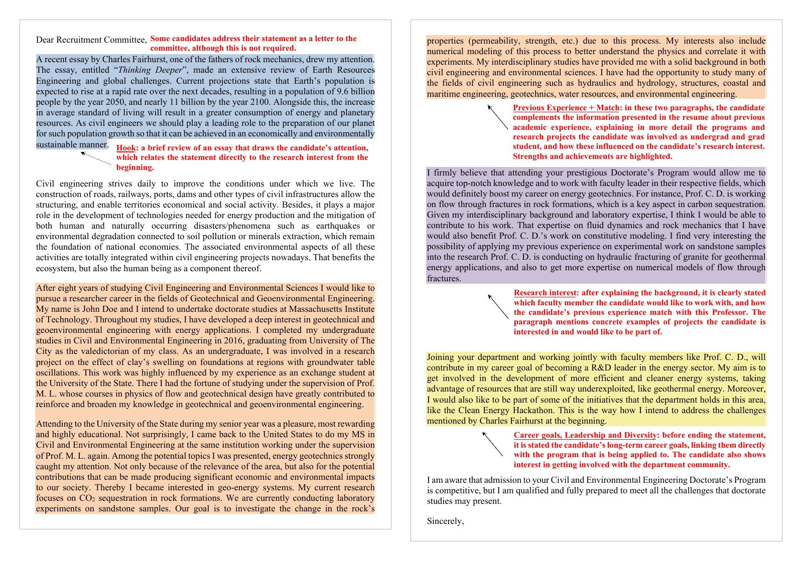
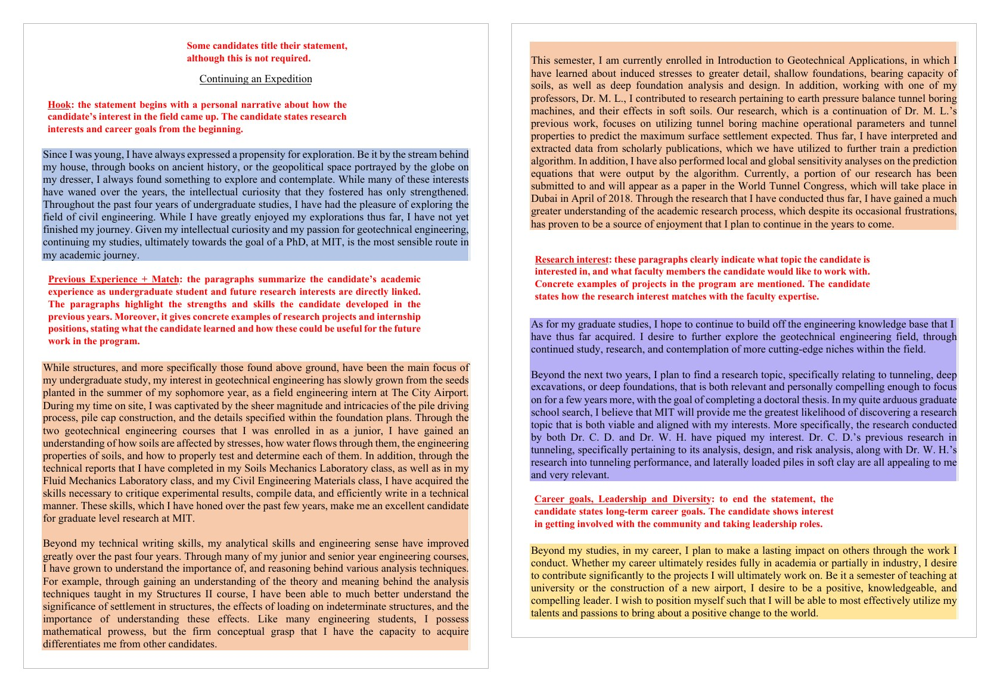

## Upcoming

::: {style="font-size: 0.9em;"}
| What | When | Points |
|---|---|---|
| **NSF GRFP deadline** &ndash; Physics & Astronomy | Oct. 23 (today), 8:00 PM ET | &ndash; |
| Graduate application workshop: bring a statement draft | Oct. 30, in class | &ndash; |
| Astrophysics/Astro Graduate Q&A (Room CCB 103) | Nov. 12, 3:30&ndash;4:30 PM ET | &ndash; |
| [Personal statement or cover letter](../assignments/personal-statement.qmd) | Nov. 20, 11:59 PM ET | 15% |
| Georgia Tech Physics PhD and BS/MS deadline | Dec. 15 | &ndash; |
:::

::: {.highlight-box}
**The goal of today's lecture:** leave with a plan for every piece of your application, and an outline of your statement of purpose to bring to next week's workshop.
:::

::: {.cite-note}
[@gt_physics_admissions; @gt_physics_bsms]
:::

---

## What a committee reads for

A faculty committee is asking one question: **will this person succeed as a graduate student and a scientist, here?**

:::: {.columns}
::: {.column width="33%"}
### Research potential

- Statement of purpose
- Letters from research mentors
:::
::: {.column width="33%"}
### Preparation

- Transcript and CV
- Skills in your statement
:::
::: {.column width="34%"}
### Fit

- The "why this program" paragraph
- Faculty you contacted
:::
::::

::: {.highlight-box}
Every piece should point the same way. Your statement makes the claims; your CV and letters back them up.
:::

::: {.cite-note}
[@mit_commlab_sop; @sps_applications2023]
:::

---

## Statement of purpose vs. personal statement

:::: {.columns style="font-size: 0.85em;"}
::: {.column width="50%"}
### Statement of purpose

Also called an *academic statement*.

- Your preparation and research experience
- Your research interests and goals
- Why **this** program and these faculty
:::
::: {.column width="50%"}
### Personal statement

Also called a *personal history statement*.

- How your background led you to graduate school
- Challenges, service, mentoring, leadership
- Should **not** repeat the statement of purpose
:::
::::

::: {style="font-size: 0.85em;"}
Some programs ask for both, some for one combined statement. **Read each prompt and answer that prompt.** [Assignment 4](../assignments/personal-statement.qmd) accepts either; write the one your target program asks for.
:::

::: {.cite-note}
[@berkeley_statements; @white_gradguide]
:::

---

## A structure that fits in 1&ndash;2 pages

::: {style="font-size: 0.8em;"}
| Section | What it does | Space |
|---|---|---|
| **Opening** | Your research interest and goal | 1 paragraph |
| **Research experience** | The question, your role, the result, what you learned | The most: half a page or more |
| **Preparation** | Courses, skills, and tools that support it | 1 paragraph |
| **Why this program** | Faculty, groups, and facilities by name | 1 paragraph, rewritten per program |
| **Goals** | Where you are headed after the degree | 2&ndash;3 sentences |

: {tbl-colwidths="[24,50,26]"}
:::

::: {.highlight-box}
Typical length is 1&ndash;2 pages, or 500&ndash;1,000 words. Defer to each program's requirements.
:::

::: {.cite-note}
[@mit_commlab_sop; @berkeley_statements]
:::

---

## Open with your research, not your childhood

:::: {.columns style="font-size: 0.85em;"}
::: {.column width="50%"}
**Before**

> Ever since I was a child looking up at the night sky, I have been fascinated by the mysteries of the universe.
:::
::: {.column width="50%"}
**After**

> I want to know how dark matter is distributed in dwarf galaxies. For two years I have fit archival rotation curves in Prof. X's group at Georgia Tech; at [Univ.] I want to test those fits against new radio data.
:::
::::

::: {.highlight-box}
By the end of your first paragraph, a reader should know your field and what you want to do.
:::

::: {.cite-note}
[@berkeley_statements; @mit_commlab_sop]
:::

---

## Writing about a research experience

:::: {.columns style="font-size: 0.9em;"}
::: {.column width="45%"}
::: {style="font-size: 0.85em;"}
For each project, give:

- **The question** in one sentence
- **Your role:** what *you* did, not what the group did
- **The method:** instruments, code, analysis
- **The result:** numbers, a talk, a poster, a paper
- **What's next:** what you learned and want to do with it
:::
:::
::: {.column width="55%"}
::: {style="font-size: 0.85em;"}
**Before**

> I worked in a condensed matter lab, where I learned a lot about the research process.

**After**

> In Prof. Y's lab, I built a four-probe setup and measured the resistivity of 14 thin films from 4 to 300 K. I presented the results at the Spring 2026 Undergraduate Research Symposium.
:::
:::
::::

::: {.cite-note}
[@mit_commlab_sop; @berkeley_statements]
:::

---

## The fit paragraph

- Name **2&ndash;3 faculty** and the specific recent work that connects to yours
- Say what you would bring to their group and what you would work on
- Mention groups, centers, or facilities you would use
- Mention any contact you've had: an email reply, a visit, a conversation at a conference

::: {.highlight-box}
Write one strong core statement. **Rewrite the fit paragraph for every program**, and check that you upload the right version to each school.
:::

::: {.cite-note}
[@sps_applications2023; @mit_commlab_sop]
:::

---

## Addressing a weak spot

A bad semester, a low grade in a core course, a gap in your record.

:::: {.columns style="font-size: 0.85em;"}
::: {.column width="50%"}
**Do**

- Say it **once**, briefly and plainly
- Show the recovery with evidence
- Put it in the personal statement or an "additional information" box if the program has one
:::
::: {.column width="50%"}
**Don't**

- Open your statement with it
- Apologize repeatedly or make excuses
- Explain more than the reader needs
:::
::::

> My Fall 2024 grades reflect a semester I worked 30 hours a week. Since then my physics GPA is 3.7, including A's in Quantum Mechanics I and II.

::: {.cite-note}
[@berkeley_statements]
:::

---

## Sentence-level style

::: {style="font-size: 0.85em;"}
| Instead of | Write |
|---|---|
| I have always been passionate about physics. | *(Cut it. Show it through what you did.)* |
| I was exposed to research in a world-renowned lab. | I wrote the analysis code for the group's 2026 cryostat run. |
| I possess strong analytical skills. | I derived and coded the fit model for &hellip; |
| Your prestigious program would allow me to&hellip; | Prof. Z's work on &hellip; is the next step from my project on &hellip; |
| Measurements were taken. | I measured &hellip; |

: {tbl-colwidths="[45,55]"}
:::

- **First person, active voice.** Numbers and names beat adjectives.
- **Show qualities, don't claim them.**

::: {.cite-note}
[@berkeley_statements; @white_gradguide; @mit_commlab_sop]
:::

---

## Example 1: an admitted statement, annotated

:::: {.columns}
::: {.column width="64%"}
{width="100%" fig-alt="Two pages of a statement of purpose that led to admission to the MIT Civil and Environmental Engineering doctoral program, with color-highlighted paragraphs and red margin annotations. The annotations label the opening as a hook that ties a recent essay to the research interest, two paragraphs as previous experience and match, a paragraph naming a specific professor and project as research interest, and a closing paragraph as career goals, leadership, and diversity."}
:::
::: {.column width="36%"}
::: {style="font-size: 0.7em;"}
**What works**

- The hook leads straight to the research interest
- Current project is specific: CO~2~ sequestration in sandstone
- Names a professor, a project, and how the applicant's lab skills fit
:::
:::
::::

::: {.cite-note}
Annotations by the MIT CEE Communication Lab &middot; CC BY-NC 4.0 &middot; Source: [@mit_commlab_sop]
:::

---

## Example 2: an admitted statement, annotated

:::: {.columns}
::: {.column width="64%"}
{width="100%" fig-alt="Two pages of a second statement of purpose, titled Continuing an Expedition, that led to admission to the MIT Civil and Environmental Engineering doctoral program, with color-highlighted paragraphs and red annotations. The annotations label a personal-narrative hook, paragraphs on previous experience and match, paragraphs on research interest naming two faculty members and their work, and a closing paragraph on career goals, leadership, and diversity."}
:::
::: {.column width="36%"}
::: {style="font-size: 0.7em;"}
**What works**

- Undergraduate research in detail: data, a prediction algorithm, sensitivity analyses, a paper submitted
- Names two faculty and the specific topics of each
:::
:::
::::

::: {.cite-note}
Annotations by the MIT CEE Communication Lab &middot; CC BY-NC 4.0 &middot; Source: [@mit_commlab_sop]
:::

---

## The personal statement

When a program asks for one, it wants to know how your background brought you to graduate school, and what you will add.

:::: {.columns style="font-size: 0.85em;"}
::: {.column width="50%"}
**What goes in**

- Formative experiences: education, family, culture, finances
- Challenges and how you responded
- Mentoring, teaching, outreach, leadership
- Context for a record that undersells you
:::
::: {.column width="50%"}
**How to write it**

- Stories with an outcome: what you did, and what it shows
- End on why graduate school, and why now
- Don't retell your statement of purpose
:::
::::

::: {.highlight-box}
It is still a professional document, written for a committee.
:::

::: {.cite-note}
[@berkeley_statements]
:::

---

## Reuse your GRFP work

If you applied to the NSF GRFP, you have already drafted most of this.

::: {style="font-size: 0.85em;"}
| GRFP document | Becomes |
|---|---|
| Graduate Research Plan | The research-interest and "what I'd work on" paragraphs of your statement of purpose |
| Personal, Relevant Background and Future Goals | Your personal statement, and the research-experience paragraphs of your statement of purpose |
| Broader Impacts, in both | Service, outreach, and mentoring in your personal statement |

: {tbl-colwidths="[35,65]"}
:::

::: {.highlight-box}
Adapt, don't paste. A different prompt, a different reader, and usually a different length.
:::

---

## Your CV for graduate school

:::: {.columns style="font-size: 0.85em;"}
::: {.column width="50%"}
**Lead with**

1. Education
2. Research experience
3. Presentations, posters, publications (mark "submitted" or "in preparation")
4. Skills: instruments, languages, codes
5. Awards, teaching, outreach
:::
::: {.column width="50%"}
**Compared with your resume**

- Research moves to the top
- Length can run past one page
- Confirmed future items are fine, e.g., an accepted conference talk
- Leave off anything that doesn't help you
:::
::::

::: {.highlight-box}
Your CV should back up every claim in your statement. More in the [resume and CV guide](../supplemental/resume-cv.qmd).
:::

::: {.cite-note}
[@white_gradguide]
:::

---

## Letters of recommendation

:::: {.columns style="font-size: 0.8em;"}
::: {.column width="50%"}
**Who**

- Programs typically ask for **three**
- Research mentors first; aim for at least two who saw you do research
- A professor from an upper-level course who knows your work

**When**

- Ask **&ge; 4 weeks** before your first deadline
- Ask, "Can you write me a strong letter?"
- Remind them a month, two weeks, and one week out
:::
::: {.column width="50%"}
**Send everything in one email**

- Your CV and a draft statement
- Courses and grades with them
- Programs, deadlines, and submission links
- Reminders of what you did together: projects, results, skills they saw

**After**

- Tell them where you got in, and thank them
:::
::::

::: {.cite-note}
[@sps_applications2023; @white_gradguide; @xavier_letters]
:::

---

## Transcripts, GRE, and English tests

:::: {.columns style="font-size: 0.85em;"}
::: {.column width="33%"}
### Transcripts

- Upload a transcript when you apply
- Official copies are usually needed only once you are admitted
:::
::: {.column width="33%"}
### GRE

- Georgia Tech Physics requires **neither** the General nor the Physics GRE; check each program
- Physics GRE fall window closes **Nov. 1**
:::
::: {.column width="34%"}
### English tests

- International applicants at Georgia Tech Physics: TOEFL &ge; 106 or IELTS &ge; 7.5
:::
::::

::: {.highlight-box}
Track every program in one spreadsheet: deadline, fee, statements, letters, and tests.
:::

::: {.cite-note}
[@gt_physics_admissions; @aapt_gre; @ets_gre_subject; @white_gradguide]
:::

## In-class activity: plan your statement

::: {style="font-size: 0.9em;"}
Fill out the [statement of purpose planning worksheet](../course-files/sop-planning-latex/phys-4604-sop-planning-worksheet.pdf) (15 minutes):

1. Your research interest, in one sentence
2. Your strongest research experience: the question, your role, the result
3. One program: 2&ndash;3 faculty and the specific work that fits yours
4. Your three letter writers, and what each can speak to
:::

::: {.highlight-box}
Turn it into a one-page draft and bring it to the **Oct. 30 workshop**.
:::

---

## References {.scrollable}

::: {#refs style="font-size: 0.7em;"}
:::
