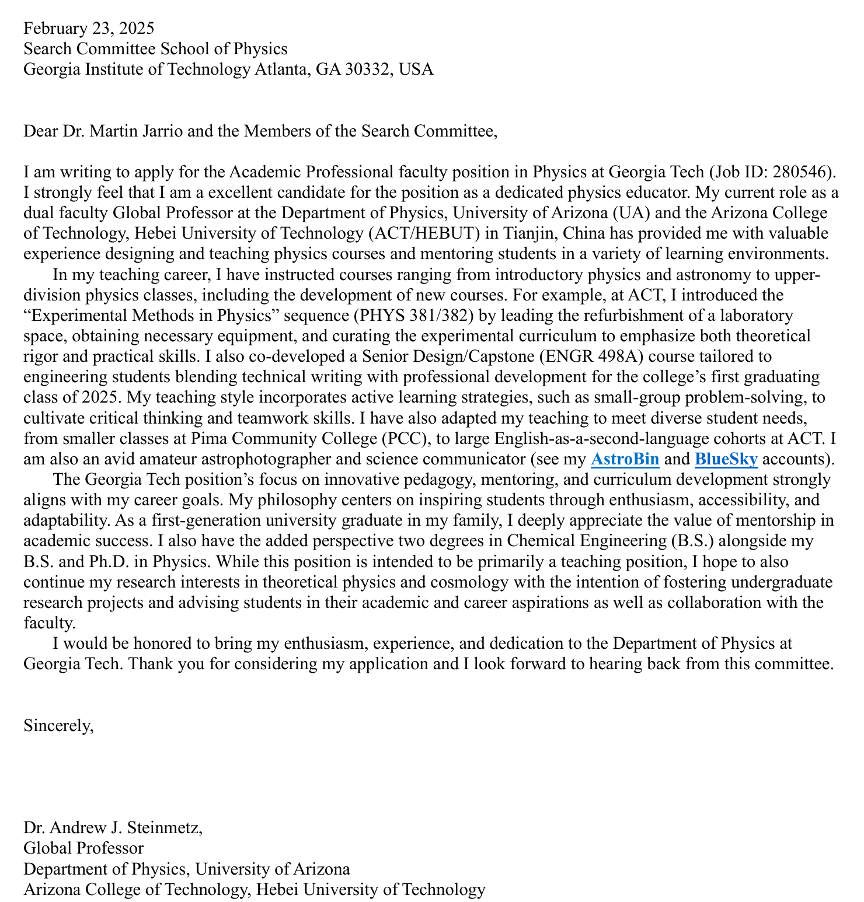

## Upcoming

::: {style="font-size: 0.9em;"}
| What | When | Points |
|---|---|---|
| Interview practice and cover letter workshop: bring a draft and your posting | Nov. 20, in class | &ndash; |
| [Personal statement or cover letter](../assignments/personal-statement.qmd) | Nov. 20, 11:59 PM ET | 15% |
| No class: Thanksgiving break | Nov. 27 | &ndash; |
| [External participation](../assignments/external-participation.qmd) | Dec. 4, 11:59 PM ET | 4% |
:::

---

## Part I: Most physics jobs don't say "physics"

::: {style="font-size: 0.8em;"}
| Category | Job titles reported by new physics bachelors |
|---|---|
| **Engineering** | Systems, Electrical, Mechanical, Test, Process, Design, Application Engineer; Engineering Technician |
| **Software** | Software Engineer/Developer, Data Engineer, Data Analyst, Data Scientist, ML Engineer, Consultant |
| **Research** | Research Assistant, Research Technician, Patent Examiner, Accelerator Operator, Physicist, Scientist |
| **Education** | High School Physics/Math Teacher, Middle School Science Teacher, Tutor |
| **Business** | Data Analyst, Research Analyst, Project Manager, Investment Banker |

: {tbl-colwidths="[18,82]"}
:::

::: {style="font-size: 0.85em;"}
- **Search by skill and tool**, not by degree: optics, lasers, vacuum, RF, metrology, test, simulation, signal processing, Python, MATLAB
- "B.S. in engineering, physics, or a related field": physics counts.
:::

::: {.cite-note}
Classes of 2021 and 2022 &middot; [@aip_bs_titles2024; @aps_bs_private]
:::

---

## Where to find industry postings

:::: {.columns style="font-size: 0.78em;"}
::: {.column width="50%"}
### Industry and government

- [CareerBuzz](https://career.gatech.edu/careerbuzz/): GT jobs and internships
- [LinkedIn Jobs](https://www.linkedin.com/jobs/): industry and networking
- [USAJOBS](https://www.usajobs.gov/): federal jobs, including entry-level physicist roles
- [Hacker News Jobs](https://news.ycombinator.com/jobs): Y Combinator startups
:::
::: {.column width="50%"}
### Physics boards that list industry jobs

- [APS Physics Jobs](https://www.apsphysicsjobs.com/): academia, labs, and industry
- [Physics Today Jobs](https://jobs.physicstoday.org/): physics and related fields

### Off the boards

- Career pages of companies and national labs you already know
- People you met at the career fair or in informational interviews
:::
::::

::: {.highlight-box}
Save every posting as a PDF when you find it. Keep your job hunt organized.
:::

---

## What a cover letter does

Your resume lists what you did. Your cover letter argues why it matters for this job.

:::: {.columns style="font-size: 0.8em;"}
::: {.column width="50%"}
### It should

- Introduce you and name the position
- Highlight **2&ndash;3** skills and experiences that match the posting (check keywords)
- Say why this field and this company; be specific
:::
::: {.column width="50%"}
### It should not

- Repeat your resume line by line
- Run past one page
- Be the same letter you send everywhere
:::
::::

::: {.highlight-box}
The cover letter presents a narrative for why you are the best candidate.
:::

::: {.cite-note}
[@gtcc_resumes]
:::

---

## Start from the posting

Before you write a word, take the posting apart.

::: {style="font-size: 0.8em;"}
| The posting asks for | Your evidence (examples) |
|---|---|
| Bachelor's in physics, optics, or engineering | B.S. Physics, Georgia Tech, May 2027 |
| Hands-on experience with lasers and optical alignment | Built and aligned a Michelson interferometer; 2 years in an optics research lab |
| Python or MATLAB for test automation | Wrote Python code that controls a lock-in amplifier and motorized stage |
| Clear technical communication | Poster at an Undergraduate Research Symposium |
| Works well on a team | Internship at Y company in the design team for 6-months |

: {tbl-colwidths="[42,58]"}
:::

::: {.highlight-box}
Pick the **top 2&ndash;3 rows** where your evidence is strongest. Those are your body paragraphs.
:::

---

## A structure that fits on one page

::: {style="font-size: 0.8em;"}
| Section | What it does | Space |
|---|---|---|
| **Header and greeting** | Same header as your resume; a named person if you can find one | &ndash; |
| **Opening** | The position and why you in one sentence | 1 short paragraph |
| **Body** | 2&ndash;3 qualifications from the posting, each with evidence | 1&ndash;2 paragraphs |
| **Why this company** | Their products, team, or mission, and why it fits your goals | 1 paragraph |
| **Close** | Thanks, availability, and an invitation to talk | 2&ndash;3 sentences |

: {tbl-colwidths="[24,52,24]"}
:::

::: {.highlight-box}
About one page with header, body text, and signature/contact info.
:::

::: {.cite-note}
[@gtcc_resumes]
:::

---

## Open with the job, not with yourself

:::: {.columns style="font-size: 0.85em;"}
::: {.column width="50%"}
**Before**

> I am writing to apply for the position at your company. I am a hard-working physics student with strong analytical skills, and I believe I would be a great fit for your team.
:::
::: {.column width="50%"}
**After**

> I am applying for the Optical Test Engineer I position that I discussed with your team at the Fall 2026 All Majors Career Fair. I have built and aligned laser systems in two labs at Georgia Tech, and I would bring that hands-on optics experience and the Python skills your posting asks for.
:::
::::

::: {.highlight-box}
By the end of your first paragraph, the reader should know which job you want and the one reason to keep reading.
:::

---

## Writing a body paragraph

:::: {.columns style="font-size: 0.9em;"}
::: {.column width="42%"}
::: {style="font-size: 0.85em;"}
For each qualification:

- **Name it** in the posting's words
- **Show it:** one specific example
- **Size it:** a number, a result, an outcome
- **Connect it:** what it means for this job
:::
:::
::: {.column width="58%"}
::: {style="font-size: 0.85em;"}
**Before**

> I have taken many lab courses and learned many technical skills, including programming and data analysis.

**After**

> In Prof. Y's lab, I wrote a Python program that controls a lock-in amplifier and a motorized stage, cutting a four-hour manual scan to 25 minutes. I then documented the code and wrote instructions so new students could run it on their own. This experience automating test equipment within a team environment matches the skills needed for your open position.
:::
:::
::::

---

## The "why this company" paragraph

It does the same job as the fit paragraph in a statement of purpose.

::: {style="font-size: 0.9em;"}
- Name something specific: a product line, a recent project, the team's work
- Mention any contact: a career fair conversation, an informational session, an alum. Leverage your network if possible.
- Connect it to your goals, not to how prestigious/high-paying they are
:::

:::: {.columns style="font-size: 0.76em;"}
::: {.column width="50%"}
**Before**

> Your company is a leader in the industry, and I would be honored to join such a prestigious organization.
:::
::: {.column width="50%"}
**After**

> When I talked with your team at the career fair, I learned that your fiber sensors now monitor bridges in three states. I want to take my laser alignment and data analysis experience from the research bench to sensors like those.
:::
::::

---

## Example: the letter that got me this job

:::: {.columns}
::: {.column width="50%"}
{fig-align="center" height="540px" fig-alt="A one-page cover letter dated February 23, 2025, from Dr. Andrew J. Steinmetz, then a Global Professor at the University of Arizona and the Arizona College of Technology, Hebei University of Technology, to the Georgia Tech School of Physics search committee, applying for the Academic Professional faculty position. Four paragraphs: the position and current role; courses taught and developed, including an Experimental Methods in Physics lab sequence and a senior capstone; fit with the position, teaching philosophy, background, and research interests; and a short closing."}
:::
::: {.column width="50%"}
::: {style="font-size: 0.66em;"}
My application for the teaching faculty job I hold now, February 2025. An academic job, but the parts of the letter are the same.

**What works**

- The first sentence names the position and job ID
- Addressed to the search chair by name
- Specific evidence: started a lab course sequence (PHYS 381/382), refurbished the lab, and co-developed a capstone course
- Teaching across very different settings, from community college to large ESL cohorts
- Uses the posting's own words: "innovative pedagogy, mentoring, and curriculum development"
- One page
:::
:::
::::

::: {.cite-note}
Signature and contact details removed.
:::

---

## Example: what I would fix today

:::: {.columns}
::: {.column width="50%"}
{fig-align="center" height="540px" fig-alt="A one-page cover letter dated February 23, 2025, from Dr. Andrew J. Steinmetz, then a Global Professor at the University of Arizona and the Arizona College of Technology, Hebei University of Technology, to the Georgia Tech School of Physics search committee, applying for the Academic Professional faculty position. Four paragraphs: the position and current role; courses taught and developed, including an Experimental Methods in Physics lab sequence and a senior capstone; fit with the position, teaching philosophy, background, and research interests; and a short closing."}
:::
::: {.column width="50%"}
::: {style="font-size: 0.66em;"}
- Typos: "a[n] excellent"; "perspective [of] two degrees"
- Fluff: "I strongly feel that I am a excellent candidate."
- No numbers: how many courses, sections, students?
- Meandering third paragraph: philosophy, background, chemical engineering, research
- Hedging/low-confidence: "While this position is intended to be primarily a teaching position&hellip;"
- Unjustified hobby: astrophotography not connected to teaching
- Little about Georgia Tech: no courses, programs, or people by name
:::
:::
::::

---

## Part II: How a typical hiring process runs

:::: {.columns style="font-size: 0.85em;"}
::: {.column width="25%"}
### 1. Screen

- Phone or video, about 30 minutes
- Often a recruiter
- Fit, interest, logistics
:::
::: {.column width="25%"}
### 2. First interview

- Hiring manager or team member
- Your experience and the role
- Sometimes recorded, one-way video
:::
::: {.column width="25%"}
### 3. Final round

- On-site or a long video call
- Several interviewers back to back
- Technical questions; maybe a short talk
:::
::: {.column width="25%"}
### 4. Offer

- Usually by phone first
- Get it in writing
- Then decide or negotiate
:::
::::

::: {.highlight-box}
Every round asks the same three questions: **Can you do the job? Do you want this job? Will we want to work with you?**
:::

::: {.cite-note}
[@aps_interview; @gtcc_interviewing]
:::

---

## Four kinds of questions

:::: {.columns style="font-size: 0.85em;"}
::: {.column width="50%"}
### Behavioral

"Tell me about a time you&hellip;"

- Solved a hard problem
- Disagreed with a teammate
- Made a mistake

### Technical

- Explain your project
- The physics of your instrument
- An estimate, a calculation, or code
:::
::: {.column width="50%"}
### Motivation and fit

- "Tell me about yourself."
- "Why this company? Why this role?"
- "Where do you see yourself in five years?"

### Yours

- "What questions do you have for us?"
- **Always** have some
:::
::::

::: {.cite-note}
[@gtcc_interviewing; @aps_interview]
:::

---

## "Tell me about yourself"

A 60&ndash;90 second answer: **present, past, future.**

:::: {.columns style="font-size: 0.9em;"}
::: {.column width="35%"}
- **Present:** who you are now
- **Past:** one or two experiences that matter for this job
- **Future:** why this role is the next step
:::
::: {.column width="65%"}
> I'm a fourth-year Physics major at Georgia Tech. For the last two years I've worked in an optics lab, where I built a laser measurement setup and wrote the Python code that runs it. That work showed me I like building and debugging instruments more than anything else, which is why this test engineering role caught my eye.
:::
::::

::: {.highlight-box}
It is not your life story. It is the opening paragraph of your cover letter, said out loud.
:::

---

## Behavioral questions: the STAR method

:::: {.columns style="font-size: 0.85em;"}
::: {.column width="40%"}
- **S**ituation: the context, in one or two sentences
- **T**ask: what *you* were responsible for
- **A**ction: what *you* did, step by step. The biggest part of your answer.
- **R**esult: what happened, with numbers; or what you learned
:::
::: {.column width="60%"}
"Tell me about a time you solved a technical problem under a deadline."

> **S:** A week before our Advanced Lab report was due, our interferometer data were too noisy to resolve the sodium doublet. **T:** I was responsible for data acquisition. **A:** I traced the noise to building vibration, moved the setup to an isolation table, and rewrote our script to average 20 scans. **R:** The noise dropped by a factor of five, we measured the splitting within 2% of the accepted value, and we submitted on time.
:::
::::

::: {.cite-note}
[@orise_star; @gtcc_interviewing]
:::

---

## Build a story bank

Prepare **several STAR stories** before any interview. One good story can answer several questions.

::: {style="font-size: 0.75em;"}
| Story about&hellip; | Answers questions like&hellip; |
|---|---|
| A technical problem you solved | "a hard problem," "a time you used data to decide" |
| Working on a team | "a disagreement," "a time you helped a teammate" |
| A mistake or failure | "a time you failed," "something you would do differently" |
| Taking initiative | "leadership," "going beyond what was asked" |
| Learning something fast | "a new tool or skill," "working outside your comfort zone" |
| A deadline under pressure | "managing competing priorities," "working under stress" |

: {tbl-colwidths="[38,62]"}
:::

::: {.highlight-box}
Practice them **out loud**, not just in your head. Each one should take about two minutes.
:::

::: {.cite-note}
[@gtcc_interviewing; @aps_interview]
:::

---

## Technical questions as a physicist

:::: {.columns style="font-size: 0.78em;"}
::: {.column width="50%"}
### Explain your project at three depths

- 30 seconds for anyone
- 2 minutes for an engineer/scientist outside your field
- Expertise on the methods and your role

### Know your resume

- Every tool, language, and instrument on it is fair game
:::
::: {.column width="50%"}
### Thinking out loud

- Estimates and calculations: state your assumptions, then reason
- Code: talk through your approach before you type
- "I don't know, but here is how I would find out" is a good answer. Don't BS.
:::
::::

::: {.highlight-box}
The interviewer is grading **how you think**, not just whether you land on the right number. Physics training is good preparation for this.
:::

::: {.cite-note}
[@gtcc_interviewing]
:::

---

## Questions to ask them

:::: {.columns style="font-size: 0.85em;"}
::: {.column width="50%"}
### Good questions

- What does success look like in this role after six months?
- What does a typical week look like for the team?
- How do new hires learn the tools and methods you use?
- What do you enjoy most about working here?
- What are the next steps in the process?
:::
::: {.column width="50%"}
### Save for later

- Salary and benefits: wait for them to raise it, or for an offer
- Anything answered on the company's website

### After the interview

- A short, specific thank-you email within a day
- Write down what they asked while you remember it
:::
::::

::: {.cite-note}
[@aps_interview]
:::

---

## Part III: Graduate school visits

::: {style="font-size: 0.8em;"}
| Industry interview | Graduate school interview or visit |
|---|---|
| "Tell me about yourself." | "Tell me about your research." |
| STAR story: a technical problem you solved | "What went wrong in your project, and what did you do?" |
| "Why this company?" | "Why this program? Whose group interests you?" |
| Know every line of your resume | Know every line of your CV and statement |
| Questions for the hiring manager | Questions for faculty **and** current graduate students |
| Thank-you email after the interview | Thank-you email, especially to faculty whose groups you might join |
| Get the offer in writing | Get the funding offer in writing |

: {tbl-colwidths="[45,55]"}
:::

::: {.highlight-box}
Your story bank works for both. A research project told in STAR form is a strong answer in either room.
:::

---

## Graduate school interviews and visits

:::: {.columns style="font-size: 0.78em;"}
::: {.column width="33%"}
### Before

- Pick 3&ndash;5 faculty whose work interests you
- Read a recent paper from each
- Write your questions down
:::
::: {.column width="33%"}
### During

- Talk with current students, ideally in groups you'd join
- Ask faculty about mentoring style and whether they are taking students
- Be yourself; you are interviewing them too
:::
::: {.column width="34%"}
### After

- Send thank-you emails
- Write down your impressions that night
- Talk them over with a mentor
:::
::::

::: {.highlight-box}
Many physics programs no longer hold formal admissions interviews, but faculty conversations at visits still matter. Prepare for them like interviews.
:::

::: {.cite-note}
[@perez2023]
:::

---

## References {.scrollable}

::: {#refs style="font-size: 0.7em;"}
:::
